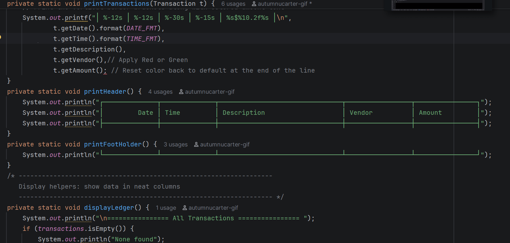

# Financial Tracker

## Description of the Project

- Financial tracker is a basic ledger that keeps a company's transaction history in a csv file. Every transactions date, time, description, vendor, and price.

## Features

- It allows the user to add deposits, make payments and storing it into the file. 
- While also being able to view all and search by date.

## User Stories

- As the user, I want to be able to filter my transactions, so i can see different transactions from month to month or year to year.
- As the user, i want to be able to use the filter, so i can filter by any of the categorizes to see any transactions.
- As the user, I want to be able to use the filter to go by vendor, so i can see all past deposits or payments to specific businesses.
- As the user, I want to be able to click the deposit option, so I can see all previous deposits from newest to oldest.
- As the editor, I want to add this method, so the code wont be repetitive under deposit and payment.
- As the user, I want to view my previous transactions, so I can see all deposit made and payment taken from the account.
- As the user, I want to use the display payment feature, so i can see all past payments made.
- As a editor, i need to add methods for all of the options, so the user can properly click through the option with accurate and clear result.
-  As the user, i want to be able to click on "A" in the Ledger Menu, so i can use the option to check previous transactions.
-  As the user i want to be able to click on "D" in the Ledger Menu, so I can use the option to see entries that are deposit only.
-  As the user i want to be able to click on "P" in the Ledger Menu, so I can use the option to see the payments only.
-  As the user i want to be able to click on "R" in the Ledger Menu, so I can use the option to see the report or custom search for the report.
- As the editor, i want to complete the methods for the report, so the user can use these features.
- As the user i want to be able to click on "MTD" in the Report Menu, so I can use the option to see month to month.
- As the user i want to be able to click on "PM" in the Report Menu, so I can use the option
- As the user i want to be able to click on "YTD" in the Report Menu, so I can use the option to see year to year
- As the user i want to be able to click on "PY" in the Report Menu, so I can use the option to see  As the user i want to be able to click on "H" in the Ledger Menu, so I can use the option to go back to the home screen

## Setup

### Prerequisites

- Java 17 (Amazon Corretto), the version used in class.
- IntelliJ IDEA Community Edition: <https://www.jetbrains.com/idea/download/>

### Running the application

1. Clone this repository, or download it as a zip and unzip it.
2. In IntelliJ: File > Open, pick the project folder (the one that holds `pom.xml`), press Open.
3. Wait for IntelliJ to finish indexing (progress bar at the bottom).
4. Open `src/main/java/com/pluralsight/YourMainClassName.java`. <!-- replace YourMainClassName with the class that has main -->
5. Right-click inside the file and choose Run 'YourMainClassName.main()'.

### Data and configuration

<!-- OPTIONAL. Anything the program needs that is not code: data files and where they must sit, files the
     program creates, a database script to run first, a settings file to edit (connection, port).
     If there is nothing, delete this subsection, heading included.
     Example:
     - `inventory.csv` sits at the project root, next to `pom.xml`. The program reads it at start.
     - `logs.txt` is created by the program at the project root on the first run. -->

-

## Technologies Used

- Java 17
- IntelliJ IDEA
<!-- Add anything else you used: a library, Maven plugins, an external tool. For a console app this list is short. That is fine. -->

## Demo

<!-- Pictures of the app running: the console for a console app, Insomnia or Swagger for an API.
     Screenshots are enough; a GIF is a bonus.
     1. Create a folder named `images` at the project root, next to `pom.xml`.
     2. Take screenshots of the app in the IntelliJ console (the menu, one feature, one error message):
          Windows: Win + Shift + S, drag a rectangle, then paste into Paint and save as PNG, or open the
                   notification and save. Save into the `images` folder.
          Mac:     Shift + Cmd + 4, drag a rectangle. The file lands on the Desktop; move it into `images`.
     3. Name the files by what they show: `images/menu.png`, `images/search.png`.
     4. Reference each one below with a relative path. No spaces in file names.
     5. Commit the images with the rest of your work (Git > Commit shows them as unversioned files: tick them).
     Optional GIF: LICEcap (free, Windows and Mac, <https://www.cockos.com/licecap/>) records a region of the
     screen straight to a .gif. Keep it under 10 seconds and under 10 MB, save it into `images`. -->

## A piece of code I am proud of

## Future Work

- Personalize my project to specific thing/company.

## Resources

All resources used are linked below

- Java Yearup Fall 2026 Java Development Workbooks 2 & 3 <https://github.com/RayMaroun/yearup-fall-section-8-2026/tree/main/pluralsight/java-development
- Java YearUp Fall 2026 hub: <https://raymaroun.github.io/yearup-java-fall2026/>
- Color text messages <https://www.geeksforgeeks.org/java/how-to-print-colored-text-in-java-console/
- Sorting method : <https://www.w3schools.com/java/java_advanced_sorting.asp

## Author

- **Autumn Carter**

## Thanks

<!-- Optional. The people who helped: the instructor, a classmate who debugged with you, a mentor. -->

- Thank you to Raymound for the skeleton for TransactionTracker class and the README.